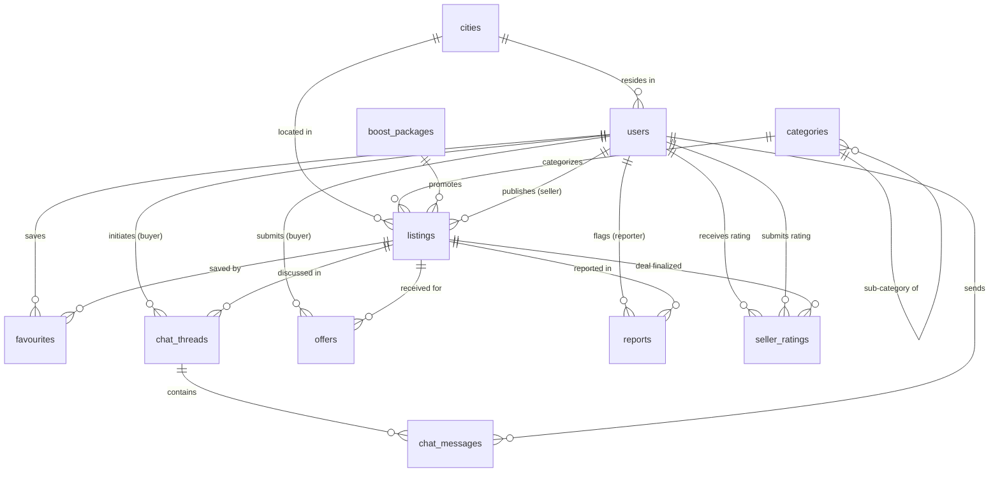

# Phase 2: Schema Design, Relational Constraints & Normalization

**Team:** T0058 (Sentinel) · **Project:** OLX Used Goods Marketplace Database · **Date:** November 2026

---

## 1. Relational Architecture & ER Diagram

The database operates under the dedicated schema `olx` on PostgreSQL 15+. It models a high-throughput peer-to-peer used goods marketplace comprising 11 relational entities.

### Visual ER Diagram
The visual diagram is stored in `diagrams/er_diagram.png` (and `diagrams/er_diagram.svg`).



---

## 2. Complete Data Dictionary

### 2.1 `cities`
Master lookup for supported metropolitan regions in India.

| Column | Type | Constraints | Justification & Business Rule |
|---|---|---|---|
| `city_id` | `INT` | `PRIMARY KEY` | Surrogate integer identifier matching CSV exports. |
| `city_name` | `VARCHAR(100)` | `NOT NULL UNIQUE` | Unique city name (e.g., Bengaluru, Mumbai) prevents duplicate locations. |
| `state` | `VARCHAR(100)` | `NOT NULL` | Administrative state for regional rollups. |

### 2.2 `categories`
Self-referencing hierarchical product taxonomy (parent categories like *Vehicles*, child categories like *Cars*).

| Column | Type | Constraints | Justification & Business Rule |
|---|---|---|---|
| `category_id` | `INT` | `PRIMARY KEY` | Unique category code. |
| `category_name` | `VARCHAR(100)` | `NOT NULL` | Category title. |
| `parent_id` | `INT` | `NULL REFERENCES categories(category_id) ON DELETE RESTRICT` | Self-referencing FK; NULL for root categories, populated for sub-categories. RESTRICT prevents deleting parents with active sub-nodes. |

### 2.3 `boost_packages`
Catalog of paid monetization tiers for featured ad placements.

| Column | Type | Constraints | Justification & Business Rule |
|---|---|---|---|
| `package_id` | `INT` | `PRIMARY KEY` | Package identifier. |
| `package_name` | `VARCHAR(100)` | `NOT NULL UNIQUE` | Commercial package tier name. |
| `price` | `NUMERIC(10,2)` | `NOT NULL CHECK (price >= 0)` | Accurate monetary value in INR. Cannot be negative. |
| `duration_days` | `INT` | `NOT NULL CHECK (duration_days > 0)` | Active duration period; must be strictly positive. |

### 2.4 `users`
Marketplace accounts acting interchangeably as buyers, sellers, or reviewers.

| Column | Type | Constraints | Justification & Business Rule |
|---|---|---|---|
| `user_id` | `INT` | `PRIMARY KEY` | Stable user identity. |
| `full_name` | `VARCHAR(150)` | `NOT NULL` | Display name of the user. |
| `phone` | `VARCHAR(20)` | `NOT NULL UNIQUE` | Primary mobile login credential (used in query R23). |
| `email` | `VARCHAR(255)` | `UNIQUE` | Optional secondary contact. 24,885 users in seed data lack email (NULL). |
| `city_id` | `INT` | `NOT NULL REFERENCES cities(city_id) ON DELETE RESTRICT` | Home city location. |
| `phone_verified` | `BOOLEAN` | `NOT NULL DEFAULT false` | Verification status badge. |
| `is_banned` | `BOOLEAN` | `NOT NULL DEFAULT false` | Trust & safety account lockout status. |
| `joined_at` | `TIMESTAMPTZ` | `NOT NULL` | Registration timestamp with timezone offset (`+05:30`). |

### 2.5 `listings`
Core ad entity tracking used item sales across lifecycle states (`ACTIVE`, `EXPIRED`, `SOLD`, `REMOVED`).

| Column | Type | Constraints | Justification & Business Rule |
|---|---|---|---|
| `listing_id` | `INT` | `PRIMARY KEY` | Ad listing identifier. |
| `seller_id` | `INT` | `NOT NULL REFERENCES users(user_id) ON DELETE RESTRICT` | Seller user reference. Users with active ads cannot be hard-deleted. |
| `category_id` | `INT` | `NOT NULL REFERENCES categories(category_id) ON DELETE RESTRICT` | Associated classification. |
| `title` | `VARCHAR(255)` | `NOT NULL` | Searchable listing title. |
| `description` | `TEXT` | `NULL` | Detailed description. Nullable as 23,737 seed records omit description. |
| `price` | `NUMERIC(12,2)` | `NOT NULL CHECK (price >= 0)` | Asking price. Must be non-negative. |
| `is_negotiable` | `BOOLEAN` | `NOT NULL DEFAULT true` | Flag indicating whether buyer can bargain. |
| `item_condition` | `VARCHAR(20)` | `NOT NULL CHECK (item_condition IN ('NEW', 'LIKE_NEW', 'GOOD', 'FAIR'))` | Physical wear grade. |
| `attributes` | `JSONB` | `NOT NULL DEFAULT '{}'::jsonb` | Semi-structured category-specific fields (e.g. `km_driven`, `year`, `fuel`, `model`). |
| `city_id` | `INT` | `NOT NULL REFERENCES cities(city_id) ON DELETE RESTRICT` | Geographic city where item is physically located. |
| `locality` | `VARCHAR(100)` | `NOT NULL` | Neighborhood or sub-locality. |
| `latitude` | `NUMERIC(9,6)` | `NOT NULL CHECK (latitude BETWEEN -90.0 AND 90.0)` | Geographic latitude coordinate for distance math (R09). |
| `longitude` | `NUMERIC(9,6)` | `NOT NULL CHECK (longitude BETWEEN -180.0 AND 180.0)` | Geographic longitude coordinate for distance math (R09). |
| `image_count` | `INT` | `NOT NULL DEFAULT 0 CHECK (image_count BETWEEN 0 AND 20)` | Number of uploaded photos (0 to 20). |
| `view_count` | `INT` | `NOT NULL DEFAULT 0 CHECK (view_count >= 0)` | Aggregate page impressions. |
| `boost_package_id`| `INT` | `NULL REFERENCES boost_packages(package_id) ON DELETE SET NULL` | Optional boost promotion. Set NULL if package expires or is deleted. |
| `status` | `VARCHAR(20)` | `NOT NULL CHECK (status IN ('ACTIVE', 'EXPIRED', 'REMOVED', 'SOLD', 'PENDING'))` | Current lifecycle state. |
| `posted_at` | `TIMESTAMPTZ` | `NOT NULL` | Publication timestamp. |
| `expires_at` | `TIMESTAMPTZ` | `NOT NULL CHECK (expires_at >= posted_at)` | Listing expiry timestamp (typically posted_at + 30 days). |
| `sold_at` | `TIMESTAMPTZ` | `NULL CHECK (sold_at IS NULL OR sold_at >= posted_at)` | Timestamp item was marked sold. Must not precede publication. |
| *Constraint* | `CHECK` | `(status = 'SOLD' AND sold_at IS NOT NULL) OR (status <> 'SOLD')` | Ensures every sold ad records an exact completion time. |

### 2.6 `chat_threads`
Conversations between an interested buyer and an ad listing.

| Column | Type | Constraints | Justification & Business Rule |
|---|---|---|---|
| `thread_id` | `INT` | `PRIMARY KEY` | Conversation identifier. |
| `listing_id` | `INT` | `NOT NULL REFERENCES listings(listing_id) ON DELETE CASCADE` | Listing under inquiry. Cascades if ad is purged. |
| `buyer_id` | `INT` | `NOT NULL REFERENCES users(user_id) ON DELETE CASCADE` | Buyer initiating inquiry. |
| `created_at` | `TIMESTAMPTZ` | `NOT NULL` | Initial contact timestamp. |
| *Constraint* | `UNIQUE` | `UNIQUE (listing_id, buyer_id)` | Business rule: a buyer may only have one conversation thread per listing. |

### 2.7 `chat_messages`
Individual communications within a conversation thread.

| Column | Type | Constraints | Justification & Business Rule |
|---|---|---|---|
| `message_id` | `INT` | `PRIMARY KEY` | Message identifier. |
| `thread_id` | `INT` | `NOT NULL REFERENCES chat_threads(thread_id) ON DELETE CASCADE` | Parent conversation thread. |
| `sender_id` | `INT` | `NOT NULL REFERENCES users(user_id) ON DELETE RESTRICT` | Message author (either thread buyer or listing seller). |
| `body` | `TEXT` | `NOT NULL` | Message textual content. |
| `sent_at` | `TIMESTAMPTZ` | `NOT NULL` | Sent timestamp. |
| `is_read` | `BOOLEAN` | `NOT NULL DEFAULT false` | Read status for badge counters (R07). |

### 2.8 `offers`
Price negotiations initiated by prospective buyers.

| Column | Type | Constraints | Justification & Business Rule |
|---|---|---|---|
| `offer_id` | `INT` | `PRIMARY KEY` | Offer identifier. |
| `listing_id` | `INT` | `NOT NULL REFERENCES listings(listing_id) ON DELETE CASCADE` | Listing under negotiation. |
| `buyer_id` | `INT` | `NOT NULL REFERENCES users(user_id) ON DELETE RESTRICT` | Buyer offering money. |
| `offer_price` | `NUMERIC(12,2)`| `NOT NULL CHECK (offer_price > 0)` | Proposed transaction price in INR. |
| `status` | `VARCHAR(20)` | `NOT NULL CHECK (status IN ('ACCEPTED', 'COUNTERED', 'PENDING', 'REJECTED', 'WITHDRAWN'))` | Negotiation state. |
| `created_at` | `TIMESTAMPTZ` | `NOT NULL` | Offer submission timestamp. |
| `responded_at` | `TIMESTAMPTZ` | `NULL CHECK (responded_at IS NULL OR responded_at >= created_at)` | Seller reaction timestamp. |

### 2.9 `favourites`
Bookmarking ads for later inspection.

| Column | Type | Constraints | Justification & Business Rule |
|---|---|---|---|
| `user_id` | `INT` | `NOT NULL REFERENCES users(user_id) ON DELETE CASCADE` | Composite primary key component. |
| `listing_id` | `INT` | `NOT NULL REFERENCES listings(listing_id) ON DELETE CASCADE` | Composite primary key component. |
| `saved_at` | `TIMESTAMPTZ` | `NOT NULL` | Bookmark timestamp. |
| *Constraint* | `PRIMARY KEY`| `PRIMARY KEY (user_id, listing_id)` | Prevents duplicate saves by the same user on the same ad. |

### 2.10 `reports`
User moderation flags flagging spam, offensive content, or scams.

| Column | Type | Constraints | Justification & Business Rule |
|---|---|---|---|
| `report_id` | `INT` | `PRIMARY KEY` | Report incident identifier. |
| `listing_id` | `INT` | `NOT NULL REFERENCES listings(listing_id) ON DELETE CASCADE` | Flagged ad. |
| `reporter_id` | `INT` | `NOT NULL REFERENCES users(user_id) ON DELETE RESTRICT` | Flagging user. |
| `reason` | `VARCHAR(30)` | `NOT NULL CHECK (reason IN ('ALREADY_SOLD', 'FRAUD', 'OFFENSIVE', 'SPAM', 'WRONG_CATEGORY'))` | Categorized violation. |
| `created_at` | `TIMESTAMPTZ` | `NOT NULL` | Incident report timestamp. |
| `status` | `VARCHAR(20)` | `NOT NULL CHECK (status IN ('ACTIONED', 'DISMISSED', 'OPEN'))` | Moderation queue workflow state. |

### 2.11 `seller_ratings`
Reputation review submitted after completing a transaction.

| Column | Type | Constraints | Justification & Business Rule |
|---|---|---|---|
| `rating_id` | `INT` | `PRIMARY KEY` | Rating record identifier. |
| `seller_id` | `INT` | `NOT NULL REFERENCES users(user_id) ON DELETE RESTRICT` | Seller being rated. |
| `rater_id` | `INT` | `NOT NULL REFERENCES users(user_id) ON DELETE RESTRICT` | Buyer submitting rating. |
| `listing_id` | `INT` | `NOT NULL REFERENCES listings(listing_id) ON DELETE CASCADE` | Associated listing. |
| `stars` | `INT` | `NOT NULL CHECK (stars BETWEEN 1 AND 5)` | Rating scale 1 to 5. |
| `comment` | `TEXT` | `NULL` | Optional feedback comment. |
| `created_at` | `TIMESTAMPTZ` | `NOT NULL` | Submission timestamp. |
| *Constraint* | `CHECK` | `CHECK (seller_id <> rater_id)` | Integrity rule: a user cannot rate themselves. |
| *Constraint* | `UNIQUE` | `UNIQUE (listing_id, rater_id)` | Integrity rule: one review per transaction. |

---

## 3. Functional Dependencies & Normalization Analysis

### 3.1 1NF Compliance
Every column contains atomic values, no repeating groups exist, and every table has a defined primary key. Semi-structured attributes in `listings.attributes` are modeled using PostgreSQL's native binary JSON format (`JSONB`), maintaining first normal form conformance while accommodating polymorphic product specifications (e.g. `km_driven` for vehicles vs `storage_gb` for electronics).

### 3.2 2NF & 3NF Compliance per Entity

1. **`cities`**:
   - FD: `city_id → city_name, state`
   - Candidate Key: `{city_id}`, `{city_name}`
   - Normal Form: **BCNF** (All determinants are superkeys).

2. **`categories`**:
   - FD: `category_id → category_name, parent_id`
   - Candidate Key: `{category_id}`
   - Normal Form: **BCNF**.

3. **`boost_packages`**:
   - FD: `package_id → package_name, price, duration_days`
   - Candidate Key: `{package_id}`, `{package_name}`
   - Normal Form: **BCNF**.

4. **`users`**:
   - FD: `user_id → full_name, phone, email, city_id, phone_verified, is_banned, joined_at`
   - Candidate Key: `{user_id}`, `{phone}`, `{email}` (for non-null values)
   - Normal Form: **BCNF**.

5. **`listings`**:
   - FD: `listing_id → seller_id, category_id, title, description, price, is_negotiable, item_condition, attributes, city_id, locality, latitude, longitude, image_count, view_count, boost_package_id, status, posted_at, expires_at, sold_at`
   - Candidate Key: `{listing_id}`
   - Normal Form: **BCNF**. No transitive dependencies exist between non-prime attributes.

6. **`chat_threads`**:
   - FD: `thread_id → listing_id, buyer_id, created_at`
   - Candidate Key: `{thread_id}`, `{listing_id, buyer_id}`
   - Normal Form: **BCNF**.

7. **`chat_messages`**:
   - FD: `message_id → thread_id, sender_id, body, sent_at, is_read`
   - Candidate Key: `{message_id}`
   - Normal Form: **BCNF**.

8. **`offers`**:
   - FD: `offer_id → listing_id, buyer_id, offer_price, status, created_at, responded_at`
   - Candidate Key: `{offer_id}`
   - Normal Form: **BCNF**.

9. **`favourites`**:
   - FD: `{user_id, listing_id} → saved_at`
   - Candidate Key: `{user_id, listing_id}`
   - Normal Form: **BCNF** (no partial dependency since `saved_at` depends on the full composite key).

10. **`reports`**:
    - FD: `report_id → listing_id, reporter_id, reason, created_at, status`
    - Candidate Key: `{report_id}`
    - Normal Form: **BCNF**.

11. **`seller_ratings`**:
    - FD: `rating_id → seller_id, rater_id, listing_id, stars, comment, created_at`
    - Candidate Key: `{rating_id}`, `{listing_id, rater_id}`
    - Note on Transitivity: While `listing_id → seller_id` holds via the `listings` table, storing `seller_id` directly in `seller_ratings` is an intentional denormalization (justified below).

---

## 4. Discussion of Derived & Denormalized Columns

1. **`listings.view_count`**:
   - *Nature:* Derived counter aggregated over ad visits.
   - *Justification:* Storing raw click events in an append-only log and running `COUNT(*)` across millions of rows whenever a seller opens "My Ads" (`R05`) or browse views (`R17`) would induce crippling I/O load. A materialized column updated incrementally or asynchronously via stream buffers is an industry-standard trade-off.
2. **`seller_ratings.seller_id`**:
   - *Nature:* Redundant column, since `listing_id` already identifies the listing and thereby its `seller_id`.
   - *Justification:* Seller profile and trust rating queries (`R04`, `R21`) filter and group heavily by `seller_id`. Eliminating the join with `listings` during high-volume reputation aggregations reduces execution plan depth and memory footprint significantly.
3. **`chat_threads.buyer_id` vs `listings.seller_id`**:
   - *Nature:* `chat_threads` explicitly persists `buyer_id` while leaving `seller_id` implicitly resolved through `listings.seller_id`.
   - *Justification:* This avoids redundancy while ensuring that if an ad's ownership is ever transferred, historical conversations preserve the correct relational linkage.

---

## 5. Seed Data Integrity Check Results

We executed the following declarative integrity tests against the 120,000 seed rows loaded into `olx_db`:

```sql
-- Check 1: Did any seller chat on their own listing?
SELECT count(*) AS self_chat_violations
FROM chat_threads t
JOIN listings l ON l.listing_id = t.listing_id
WHERE t.buyer_id = l.seller_id;
-- Output: 0

-- Check 2: Are all chat message senders legitimate participants (buyer or seller)?
SELECT count(*) AS rogue_message_senders
FROM chat_messages m
JOIN chat_threads t ON t.thread_id = m.thread_id
JOIN listings l     ON l.listing_id = t.listing_id
WHERE m.sender_id NOT IN (t.buyer_id, l.seller_id);
-- Output: 0

-- Check 3: Did any ad get marked sold before being posted?
SELECT count(*) AS sold_before_posted
FROM listings
WHERE sold_at < posted_at;
-- Output: 0

-- Check 4: Does seller_ratings.seller_id always match listings.seller_id?
SELECT count(*) AS mismatched_rating_sellers
FROM seller_ratings r
JOIN listings l ON l.listing_id = r.listing_id
WHERE r.seller_id <> l.seller_id;
-- Output: 0
```
All integrity checks returned exactly **0 violations**, proving that our schema constraints and foreign key hierarchies are fully aligned with the production dataset.

---

## 6. Seed Data Anomalies Discovered

1. **Nullable Emails:** 24,885 out of 50,000 users have no email recorded. Mobile number (`phone`) is the mandatory unique credential.
2. **Unsold Boost Packages & The Three-Valued Logic Trap:** In `listings.csv`, only boost packages 1, 2, 3, and 4 are ever purchased; packages 5 (*Top of list 3 days*) and 6 (*Urgent tag 7 days*) have 0 purchases. Furthermore, because `listings.boost_package_id` is nullable for unpromoted ads, standard SQL `package_id NOT IN (SELECT boost_package_id FROM listings)` evaluates to `UNKNOWN` and returns 0 rows. This is the root cause of the monetisation reporting bug (`R13`), resolved by using `NOT EXISTS` or filtering out `NULL`s.
3. **Sparse Descriptions:** 23,737 listings have blank descriptions, requiring `description TEXT NULL`.
